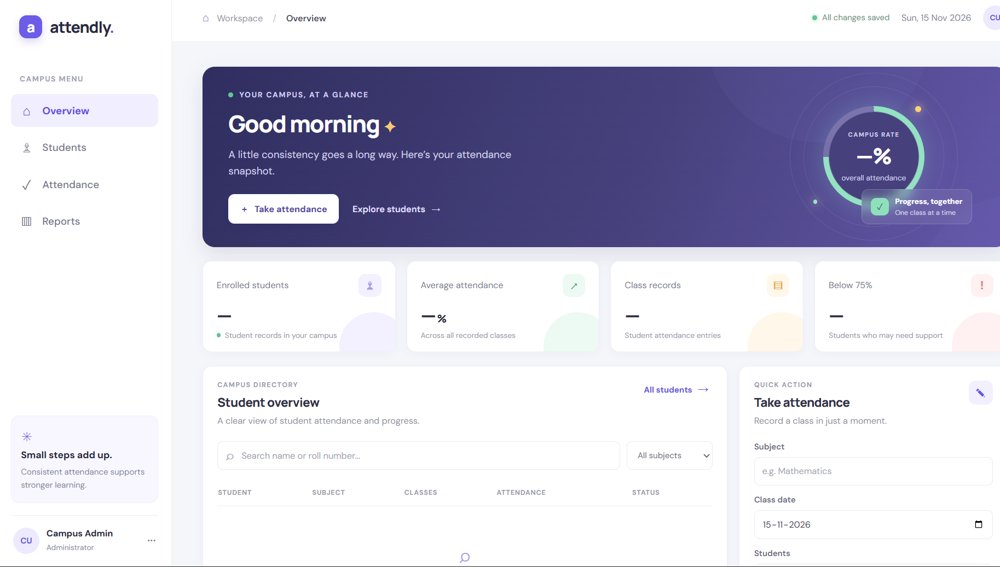
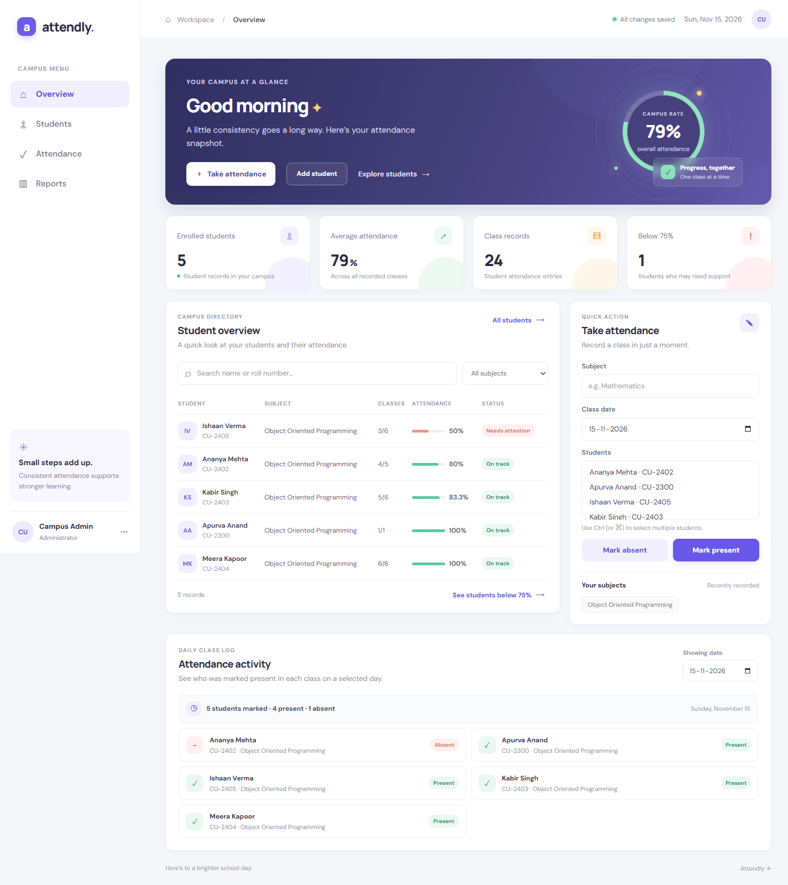

# Attendly — Student Attendance Management System

Attendly is a small web application for managing university students and recording class attendance. The project combines a Spring Boot REST API, a browser-based dashboard, `JdbcTemplate` database access, and a persistent H2 database.

This README is also the project report: it describes the requirements, design, folder structure, code, database, API, setup, and day-to-day usage.

## Contents

- [Project overview](#project-overview)
- [Requirements and objectives](#requirements-and-objectives)
- [Screenshots](#screenshots)
- [Technology and architecture](#technology-and-architecture)
- [Folder structure](#folder-structure)
- [Code walkthrough](#code-walkthrough)
- [Database design](#database-design)
- [REST API reference](#rest-api-reference)
- [Run the project](#run-the-project)
- [Use the dashboard](#use-the-dashboard)
- [Data, configuration, and troubleshooting](#data-configuration-and-troubleshooting)
- [Scope and possible improvements](#scope-and-possible-improvements)

## Project overview

Universities need a convenient way to maintain student records, record attendance for individual classes, calculate attendance percentages, and identify students who may need support. Attendly provides these capabilities through a responsive dashboard and a set of JSON API endpoints.

The application runs locally. Spring Boot serves both the dashboard and the API; H2 stores records in a local database file. No separate database server or frontend development server is needed.

## Requirements and objectives

The project is designed to:

1. Add, update, delete, and search student records.
2. Record whether each student was present or absent for a subject on a particular date.
3. Calculate subject-wise attendance percentages.
4. Identify students with subject attendance below 75%.
5. Show a date-filtered log of recorded attendance.
6. Store records between application restarts.

### Main user features

- **Overview:** campus attendance rate, enrolled-student count, attendance-record count, and students with a subject below the 75% threshold.
- **Student management:** add and edit student details, search the directory, and delete students and their associated attendance.
- **Attendance entry:** select a subject, date, and one or more students, then mark the selection present or absent.
- **Reports:** review each student's subject-wise classes attended, classes held, percentage, and status; filter by subject and search.
- **Daily class log:** select a date and see students recorded as present or absent for that day.

## Screenshots

The first image is the screenshot supplied with the project request. It captures an earlier dashboard state. The second image was captured from the running, updated application and shows the dashboard populated with sample data.

**Screenshot supplied with the request**



**Updated dashboard with sample data**



## Technology and architecture

| Layer | Technology | Purpose |
|---|---|---|
| Language | Java 17 or newer | Application code |
| Application framework | Spring Boot 3.4.5 | Application startup, dependency injection, HTTP server, and REST endpoints |
| Web/API | Spring Web | Serves static dashboard files and maps HTTP requests to controllers |
| Database access | Spring JDBC / `JdbcTemplate` | Executes parameterized SQL statements |
| Database | H2 | Embedded, file-based database for persistent local storage |
| Frontend | HTML, CSS, and vanilla JavaScript | Responsive dashboard and browser-side API interactions |
| Build | Apache Maven | Resolves dependencies and builds/runs the application |

### Request flow

```text
Browser
  ├── GET / and static files ───────────> index.html, styles.css, app.js
  └── /api/... requests ────────────────> Spring MVC controllers
                                              └── JdbcTemplate
                                                    └── H2 database
```

The JavaScript fetches JSON from the API, updates the dashboard, and sends changes back to the controllers. The controllers validate requests and use `JdbcTemplate` to read or change database records. Spring Boot's static-resource handling serves the files in `src/main/resources/static`.

## Folder structure

```text
project/
├── .gitignore
├── README.md
├── pom.xml
├── docs/
│   └── images/
│       ├── attendly-dashboard.png
│       └── attendly-dashboard-live.png
├── data/                              # Created at runtime; local H2 database files
└── src/
    └── main/
        ├── java/
        │   └── edu/university/attendance/
        │       ├── AttendanceApplication.java
        │       ├── AttendanceController.java
        │       └── StudentController.java
        └── resources/
            ├── application.properties
            ├── schema.sql
            └── static/
                ├── app.js
                ├── index.html
                └── styles.css
```

Maven also generates a `target/` directory when the project is built. It contains compiled classes and the packaged application and is not source code. The `.gitignore` excludes `target/`, database files, and H2 trace files so generated artifacts and local data are not accidentally committed.

## Code walkthrough

### `pom.xml` — build and dependencies

The Maven project file identifies the project as `edu.university:attendance-manager:1.0.0` and inherits Spring Boot dependency management from version `3.4.5`. The Java compilation target is 17.

Dependencies:

- `spring-boot-starter-web` supplies Spring MVC, JSON serialization, and the embedded web server.
- `spring-boot-starter-jdbc` supplies `JdbcTemplate` and the JDBC connection pool.
- `h2` supplies the database driver at runtime. Its runtime scope means it is needed to run the application, not to compile application source.
- `spring-boot-maven-plugin` supports running the application through Maven and packaging it as an executable JAR.

### `AttendanceApplication.java` — startup and sample records

This is the application's entry point. `@SpringBootApplication` enables Spring Boot's application configuration and component scanning. The `main` method calls `SpringApplication.run(...)` to create the application context and start the HTTP server.

The `demoData` method defines a `CommandLineRunner` bean, which Spring executes after the application starts. It:

1. Checks how many students exist.
2. Inserts five sample students only when the student table is empty.
3. Inserts five sample attendance dates per sample student for **Object Oriented Programming**.

The sample attendance makes the dashboard and reports useful on first launch. Starting the app again does not add another copy when students already exist.

### `StudentController.java` — student directory API

`@RestController` marks the class as a JSON REST controller, and `@RequestMapping("/api/students")` sets the base URL for its routes. Spring injects a `JdbcTemplate` through the constructor.

The `RowMapper` converts each SQL result row into a map with JSON-friendly student field names: `id`, `rollNumber`, `name`, `department`, and `email`.

| Handler | Responsibility |
|---|---|
| `list` (`GET /api/students`) | Lists students by name. An optional `search` parameter matches student name, roll number, or department without case sensitivity. |
| `create` (`POST /api/students`) | Validates required fields and inserts a student. The response uses HTTP 201 Created. |
| `update` (`PUT /api/students/{id}`) | Updates the student's fields; returns HTTP 404 if the ID does not exist. |
| `delete` (`DELETE /api/students/{id}`) | Removes that student's attendance rows and then the student. Returns HTTP 404 if no student had the given ID, otherwise HTTP 204 No Content. |

`StudentRequest` is a Java record used to bind incoming JSON. The `validate` and `blank` methods reject missing roll number, name, or department with HTTP 400 Bad Request. Database values are passed as `JdbcTemplate` parameters rather than concatenated into SQL.

### `AttendanceController.java` — attendance, reports, and subjects

This controller uses `/api` as its base path and handles attendance-related routes.

| Handler | Responsibility |
|---|---|
| `attendance` (`GET /api/attendance`) | Lists attendance records for a date. If omitted, the date defaults to today. An optional subject filter matches the subject. |
| `mark` (`POST /api/attendance`) | Validates student ID, subject, date, and `PRESENT` or `ABSENT` status. It updates an existing student/subject/date record or inserts one if it does not exist. |
| `reports` (`GET /api/reports`) | Groups attendance by student and subject, calculates classes held, classes attended, and percentage, and optionally filters by subject, student search, or the below-75% threshold. |
| `subjects` (`GET /api/subjects`) | Returns the distinct subjects that have attendance records. |

`AttendanceRequest` is a Java record for attendance JSON. The endpoint checks that the referenced student exists before saving. Attendance status is validated in both the API and database.

### `index.html` — dashboard content

The HTML defines the dashboard's visible structure and accessible labels:

- Sidebar navigation for Overview, Students, Attendance, and Reports.
- A campus summary hero with attendance-rate visualization and shortcuts.
- Summary cards and the student/report table.
- A quick attendance form.
- A date-filtered attendance activity list.
- A dialog for adding or editing a student.
- A toast area for success and error messages.

The page loads `styles.css` for presentation and `app.js` for data and interactions. The CSS and JavaScript asset URLs include a version query parameter so browsers are less likely to reuse older cached files after an update.

### `styles.css` — presentation and responsive layout

The stylesheet defines the color palette, typography, spacing, cards, buttons, tables, dialogs, status indicators, and dashboard layout. It uses CSS Grid and Flexbox to arrange the sidebar, summary cards, report table, and quick-attendance form.

Media queries adapt the layout for narrower screens: the sidebar becomes a compact icon rail, summary cards use fewer columns, panels stack, and activity records become a single-column list. Most interface text is deliberately larger than the initial dashboard to improve readability.

### `app.js` — browser behavior

The frontend is implemented without a JavaScript framework.

- A small `api` helper wraps `fetch`, parses JSON responses, and reports unsuccessful HTTP responses as errors.
- The `state` object holds the current student list, report rows, subjects, daily records, selected view, search, and threshold filter.
- `loadData` fetches students, reports, subjects, and the selected day's attendance concurrently with `Promise.all`, then calls `render`.
- `render` updates the page title, summary cards, report/student table, attendance selector, subject chips, and daily activity.
- `escapeHtml` encodes values before inserting database-provided text into generated HTML.
- Student form listeners open the dialog and send `POST` or `PUT` requests. Table actions support editing and deleting.
- Navigation and filters reload the relevant data. The date control refreshes the daily log.
- The attendance buttons send one request for each selected student. The API upserts the record for each student, subject, and date.
- `notify` displays short-lived messages for successful actions and errors.

### `schema.sql` — database schema

Spring initializes two tables at startup:

- `students` stores each student's unique roll number, name, department, and email.
- `attendance` stores a student reference, subject, class date, and attendance status.

The schema includes primary keys, a foreign key from attendance to student, a uniqueness constraint on `(student_id, subject, attendance_date)`, and a check constraint limiting status to `PRESENT` or `ABSENT`.

### `application.properties` — runtime configuration

This file sets the application name, H2 JDBC URL and credentials, SQL initialization mode, static-resource caching, H2 console path, and HTTP port. By default, the server listens on port `8080`, and H2 stores its data in `data/attendance`.

## Database design

```text
students
--------
id             BIGINT  primary key, generated
roll_number    VARCHAR required, unique
name           VARCHAR required
department     VARCHAR required
email          VARCHAR, defaults to empty string

attendance
----------
id               BIGINT  primary key, generated
student_id       BIGINT  foreign key -> students.id
subject          VARCHAR required
attendance_date  DATE    required
status           VARCHAR required: PRESENT or ABSENT
```

The database permits at most one attendance record per student, subject, and date. Marking attendance again for the same combination updates the existing status instead of adding a duplicate.

### Attendance calculation

For each student and subject:

```text
attendance percentage = classes attended / classes held × 100
```

`classes held` is the number of attendance rows for that student's subject; `classes attended` is the number of those rows whose status is `PRESENT`. The below-threshold report uses a **strictly less than 75%** condition. Exactly 75% is not considered below threshold.

The overview's campus rate is calculated across attendance records (so students with more recorded classes contribute more rows). The “Below 75%” summary counts distinct students who have at least one reported subject below 75%.

## REST API reference

All responses use JSON except `DELETE /api/students/{id}`, which returns an empty `204 No Content` response.

| Method | Path | Parameters / body | Purpose |
|---|---|---|---|
| `GET` | `/api/students` | Optional `search` query | List students; search name, roll number, or department |
| `POST` | `/api/students` | `rollNumber`, `name`, `department`, optional `email` | Create a student |
| `PUT` | `/api/students/{id}` | Same fields as create | Update a student |
| `DELETE` | `/api/students/{id}` | Student ID in path | Delete student and attendance |
| `GET` | `/api/attendance` | Optional `date` (`YYYY-MM-DD`) and `subject` | List attendance for a date |
| `POST` | `/api/attendance` | `studentId`, `subject`, `date`, `status` | Record or update attendance |
| `GET` | `/api/reports` | Optional `subject`, `search`, `belowThreshold` | Get subject-wise attendance report |
| `GET` | `/api/subjects` | None | List subjects present in attendance records |

Example request bodies:

```json
{
  "rollNumber": "CU-2406",
  "name": "Aanya Sharma",
  "department": "Computer Science",
  "email": "aanya@university.edu"
}
```

```json
{
  "studentId": 1,
  "subject": "Object Oriented Programming",
  "date": "2026-11-15",
  "status": "PRESENT"
}
```

Example report request:

```text
GET /api/reports?subject=Object%20Oriented%20Programming&belowThreshold=true
```

## Run the project

### Prerequisites

- Java 17 or newer
- Apache Maven 3.6.3 or newer
- A modern web browser

Check that Java and Maven are available:

```powershell
java -version
mvn -version
```

### Run from the project directory (Windows)

1. Open PowerShell, Command Prompt, or the terminal inside your IDE.
2. Change to the directory containing `pom.xml`. For example:

   ```powershell
   cd "C:\Users\your-name\path\to\project"
   ```

3. Start Spring Boot:

   ```powershell
   mvn spring-boot:run
   ```

4. Wait for the startup log to report that Tomcat started on port `8080`.
5. Open [http://localhost:8080](http://localhost:8080) in your browser. Open the application through this URL, not by opening `index.html` directly from the file system.
6. Keep the terminal open while using the app. To stop the server, return to that terminal and press **Ctrl+C**.

The first Maven run downloads dependencies and may take longer than subsequent runs.

### Build a runnable JAR

From the project directory:

```powershell
mvn clean package
java -jar target/attendance-manager-1.0.0.jar
```

Then open [http://localhost:8080](http://localhost:8080). Press **Ctrl+C** in the terminal to stop the server.

## Use the dashboard

1. **Review the overview.** The top cards summarize enrolled students, attendance rate, attendance records, and students below 75%.
2. **Add a student.** Choose **Add student**, fill in the required name, roll number, and department, then save.
3. **Explore students.** Use the sidebar or the directory shortcut. Search by name or roll number, edit a record with the pencil action, or delete it with the delete action.
4. **Record attendance.** Choose a subject and class date, select one or more students, and click **Mark present** or **Mark absent**. Use Ctrl (or ⌘) when selecting multiple students.
5. **Review reports.** Choose a subject filter or open the below-75% report. Attendance is calculated from recorded classes, not an assumed timetable.
6. **Review daily activity.** Select a date in the activity section to see the records saved for that date.

If a browser was already open while frontend files were updated, use **Ctrl+Shift+R** (hard refresh) to reload the latest page and assets.

## Data, configuration, and troubleshooting

### Where data is stored

The default JDBC URL is:

```text
jdbc:h2:file:./data/attendance;DB_CLOSE_ON_EXIT=FALSE
```

The `./data` path is relative to the application's working directory, normally the project root when run with `mvn spring-boot:run`. H2 creates its database files the first time it connects. The `data/` directory is ignored by Git so local records are not included in source changes.

### H2 console

The development H2 console is available at [http://localhost:8080/h2-console](http://localhost:8080/h2-console).

| Console setting | Value |
|---|---|
| JDBC URL | `jdbc:h2:file:./data/attendance` |
| User name | `sa` |
| Password | *(leave blank)* |

This console is intended for local development and inspection.

### Change the port or database

Edit `src/main/resources/application.properties`:

- Change `server.port=8080` if port 8080 is already in use.
- Change `spring.datasource.url` to select another H2 file path or a different JDBC database URL. A different database may require adding its driver dependency and adapting database-specific SQL.

After changing the port, use the new port in the browser URL, for example `http://localhost:8081`.

### Common problems

| Problem | What to check |
|---|---|
| `mvn` is not recognized | Install Maven, add its `bin` folder to `PATH`, and open a new terminal. |
| Java or class-version error | Check `java -version`; this project targets Java 17. |
| Port 8080 is already in use | Stop the other server, or change `server.port` in `application.properties`. |
| Dashboard opens but data does not load | Start the backend with `mvn spring-boot:run`, use `http://localhost:8080` rather than a local HTML file, and check that `/api/students` responds. |
| An older layout still appears | Hard-refresh with **Ctrl+Shift+R**. The static assets also use versioned URLs and the project disables static resource caching. |
| Roll number already exists | Roll numbers are unique; edit or remove the existing record, or choose another roll number. |
| Student cannot be found in attendance report | Reports are based on recorded attendance. A student with no attendance rows is visible in the Students directory but has no subject-wise report row yet. |

## Scope and possible improvements

This is a local learning/project application. It has no login, roles, authorization, cloud deployment configuration, or automated test suite. The development H2 console is enabled, and the database uses a blank local password by default. Do not expose this configuration as-is to an untrusted network.

Possible next steps include:

- Add instructor/admin authentication and authorization.
- Add automated controller, database, and browser tests.
- Add pagination and server-side sorting for larger student directories.
- Add date-range and exportable CSV/PDF reports.
- Add subject management and course/section grouping.
- Add production database migrations and deployment-specific configuration.
